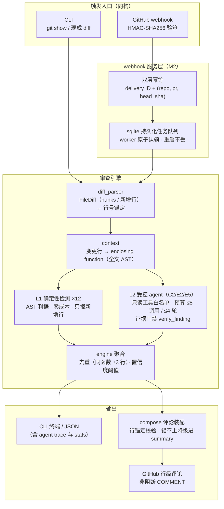
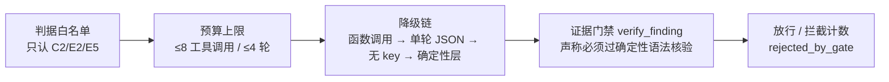

# aicr — AI Code Review Engine（M2）

PR 级 AI 审查服务的引擎层 + webhook 服务层。判据白名单、输出契约、评测口径对齐《M0-四路审查判据》v0.1。

## 当前状态

| 层 | 状态 |
|---|---|
| diff 解析（unified diff / git 双入口） | ✅ 已实测 |
| 上下文装配（变更行 → enclosing function 全文 AST） | ✅ 已实测 |
| L1 确定性检测器：C1(lite) C3(lite) C4 C5 E1(lite) E3(lite) E4 E6 + **N1 N4 M1 M4（M1.5）** | ✅ 注入回归 24/24 + 真实仓库零新增噪音 |
| PR 级聚合检测（N1 同构遗漏 / N4 改名未同步 / M1 静默放宽） | ✅ 跨文件 PR 视角，N1 为招牌判据 |
| 聚合去重（同文件 ±3 行保留最高 severity，其余挂 also_flags） | ✅ |
| 输出契约（criterion_id 白名单 / evidence 必填 / 置信度阈值） | ✅ |
| L2 受控 agent（只读工具白名单 + 预算上限 + 证据门禁） | ✅ glm-4-flash 真模型实测（幻觉 6/6 拦截） |
| **M2 webhook 服务**：HMAC 验签 / delivery+head_sha 双层幂等 / sqlite 持久化队列 / worker / 行级评论回写 | ✅ 单测 43/43 含端到端本地仿真（假 GitHub API） |
| 评论装配（行锚定校验，锚不上降级进 summary，非阻断 COMMENT） | ✅ |
| 部署材料（systemd unit + 指南，目标 124.222.174.133） | ✅ `deploy/`，待真实 webhook 联调 |

## 用法

```bash
# git 模式（M1 主路径）：审查 base..head 之间的 Python 变更
aicr review --repo /path/to/repo --base HEAD~1

# 现成 diff 模式（webhook 同构路径）
aicr review --diff pr.diff --repo /path/to/worktree

# 注入回归集
aicr eval --cases evals/cases.json --fixtures fixtures/cases

# L2 受控 agent（需 AICR_API_BASE / AICR_API_KEY / AICR_MODEL；
# 自动加载项目根 .env，见 .env.example；默认 glm-4-flash）
aicr review --repo ... --base HEAD~1 --llm

# M2 webhook 服务器（WEBHOOK_SECRET / GITHUB_TOKEN 走环境变量，部署详见 deploy/README.md）
WEBHOOK_SECRET=... GITHUB_TOKEN=... aicr serve --port 8765 --allow pengwtga/ssrm-aiops
```

零第三方依赖（纯标准库），`pip install -e .` 后获得 `aicr` 命令。

## 架构

两条入口（CLI / webhook）汇入同一个引擎——同一份代码既是产品也是评测工具：



L2 内部的四层防御（对应「受控 agent」的差异化叙事）：



设计要点（对应 M0 判据文档）：

1. **判据即白名单**：引擎只输出注册过的 criterion_id，`Finding` 构造器强制校验。
2. **只报新增行**：存量问题不报（Pre-existing 不在 M1 范围）。
3. **反例进评测集**：`fixtures/cases/` 中每个判据都有正例与"长得像但不该报"的反例，
   `aicr eval` 是判据修订的回归闸门（改判据 → 跑回归 → 三表对比）。
4. **evidence 必填**：构造器层面禁止无引用的 finding（与简历罗盘"无引用不渲染"同一哲学）。

## L2 受控 agent（M1.5）

与 Anthropic 验证式（自由 agent，算力换精度）的架构区别：**预算受限的受控 agent**。

- **只读工具白名单**（`tools.py`）：`find_symbol` / `get_function_body` / `list_callers` / `search_repo`，全部只读；
- **作用域受限**：工具只能读本次变更涉及的文件集合，仓库其余文件不可达；
- **预算硬上限**：每变更单元工具调用 ≤8 次、迭代 ≤4 轮，超限强制无工具收敛；
- **全程可回放**：每次工具调用与结果记入 trace，汇总进 stats（JSON 输出含 agent 字段）；
- **降级链**：模型无函数调用能力 → 单轮 JSON prompt（M1 路径）→ 无 key → 仅确定性层；
- **越权过滤**：L2 输出只认 C2/E2/E5，白名单外与无 evidence 的输出直接丢弃；
- **证据门禁**（`verify_finding`）：LLM 的每条声称必须通过确定性语法核验——
  E5 要求函数内真实存在 `except Exception`，E2 要求存在下标/range 计算，
  行号越出函数范围直接拦截。拦截数计入 stats（`rejected_by_gate`）。

## 真模型实测记录（glm-4-flash）

配置 `.env`（智谱 OpenAI 兼容端点）后对真实 commit 实测，得到本项目的核心教训：

- **幻觉拦截案例**：b83dbcc（42 行变更）——模型对全文件 **0 个 except** 的 `main.py`
  凭空报告 6 条 E5（置信度 0.8–1.0），且工具调用 0 次（没取证就下结论）。
  证据门禁全部拦截（`rejected_by_gate: 6`），合法放行 0 条。
- **门禁通过案例**：初始大 commit（1006 行）——34 个 L2 单元、模型声称 38 条，
  门禁拦截 32 条幻觉，放行 2 条 E5（人工核验均指向真实存在的 `except Exception`，
  是否属于"任务边界"留给人工判定），E3（`correct/total` 无零防护）由 L1 报出。
- 结论：**小模型的 L2 输出必须当作"假设"而非"结论"**——确定性门禁 + 白名单 +
  预算上限三层防御缺一不可。这也是注入夹具测不出的问题类型：夹具测检测器假设，
  真模型样本测模型的可靠性假设。

### 迭代上限扫描（experiments/iter_sweep.py）

同一批 12 个 L2 单元（含 except 正例优先），迭代上限 ∈ {1, 2, 4}：

```
上限 | 发现 | 门禁拦截 | 工具调用 | 迭代总数 | 1轮收敛 | 耗时
  1  |   2  |    10    |    0     |    12    |   12    | 45.7s
  2  |   2  |    10    |    0     |    12    |   12    | 43.6s
  4  |   2  |    10    |    0     |    12    |   12    | 48.0s
```

结论：glm-4-flash 在全部单元上 **1 轮即收敛、0 次工具调用**——迭代上限不是
当前瓶颈，`_MAX_ITERATIONS=4` 是上界保护而非实测最优值。**在本模型上"最优
循环次数"不可识别**：要测量它需要 (a) 会使用工具的模型、(b) 真值需要跨函数
证据的判据任务（C2/E2）、(c) 各档位的召回/精度/成本对照——归入 M3 评测集。
当前证据的实际含义：对局部可判的判据（E5），单轮 + 门禁已足够；多轮循环的
价值只可能出现在需要取证的判据上，这个假设待 M3 验证。

## 注入回归集

```
C5-P1/C5-N1  可变默认参数（正例 / None 默认反例）
E6-P1/E6-N1  协程未 await（正例 / await 反例）
C4-P1/C4-N1  acquire-return-release（正例 / try-finally 反例）
C3-P1/C3-N1  连接未释放（正例 / with 反例）
E4-P1/E4-N1  异常静默吞掉（正例 / 收窄+日志反例）
C1-P1/C1-N1  Optional 解引用（正例 / 判空反例）
E1-P1        空容器首元素访问
E3-P1        sum() 作除数无防护
E3-P2        行内三元守卫（反例：有守卫不报）
E6-N2        asyncio.run 消费协程（反例：合法用法不报）
N1-P1        三文件同构查询两个加租户过滤一个漏（招牌正例，多文件夹具）
N1-N1        第三函数旧上下文已有该属性（反例：预存在不报）
N1-N2        不同构工具函数（反例：相似度门槛拦截）
N4-P1/N4-N1  改名后新增代码仍用旧名（正例 / 兼容 wrapper 保留旧名反例）
M1-P1        删 assert 且全文无断言
M4-P1        新增恒假分支 if False
CLEAN-1      合规变更本底（全部判据 0 发现）
```

## 真实仓库出口检查（M1）

对 ssrm-aiops 仓库 5 个真实 commit（含 1006 行的初始大 commit）实测：

- 4 个常规 commit：0 发现，人工核验 diff 确认无判据形态问题（真阴性）
- 初始大 commit：报 1 条 E3（`correct / total` 无零防护），人工核验为真阳性
- 过程中揪出并修复 2 个检测器 bug（真实样本的价值）：
  1. E6 误报 `asyncio.run(main())` —— 任务包装器白名单补 `run` / `run_until_complete`
  2. E3 不认行内三元守卫 `round(x/total, 4) if total else 0` —— IfExp 父链守卫检查
- 已知 lite 局限：除数为表达式（如 `sum(latencies) / len(latencies)`）不覆盖，归 L2

## 路线

- **M1/M1.5 已完成**：确定性 12 判据 + L2 受控 agent（真模型实测 + 证据门禁）+ PR 级聚合检测
- **M2 已完成（待真实联调）**：webhook 服务器（HMAC 验签 / delivery+head_sha 双层幂等 /
  sqlite 持久化队列 / worker / 行级评论回写），单测 43/43 含端到端本地仿真；部署材料在 `deploy/`
- **M3**：100+ 真实 PR（Django + FastAPI）评测集，三张表 + 迭代/预算参数扫描
- **判据剩余**：N2（同模块重造）/ N3（锁顺序，需调用图装配）/ M2（复制漂移）/ M3（时序依赖）
